# 新手流程检查（2026-10-22）

在内置浏览器里从清空存档开始完整走了一遍：手机竖屏 375×812（zh）和桌面 1920×1080（en），`?ads=fake`。
窗格隐藏时 rAF 不跑，所以用 `g.tick(0.1)` 手动推帧。时间按游戏内时间算。参照的是姐妹项目 standing
的 827b4ed（卡牌提示）、2bd96c9（推荐标签）、7f7287d、779910e（失败后只给一个下一步）、cd2356d，以及
记忆里的 first-minute-live-battle、first-three-battles、crazygames-lessons-from-standing 三条笔记。

✅ 没问题　⚠️ 能用，但有摩擦　❌ 卡住或走进死路（本次已修的标 🔧）

## 步骤表

下表是当时（还有 8 s 代打）的走查记录；2026-10-25 起教学改为停住战斗等玩家，不再代打，见文末「第三轮」。

| # | 步骤 | 时间 | 结果 | 说明 |
|---|------|------|------|------|
| 1 | 首次加载 → 直接进战斗 | 0 s | ✅ | 没有标题页点击，战斗直接开始（符合 b15f071） |
| 2 | 教学 1/4 召唤 | 0–8 s | ✅ | 8 s 不动就自动召唤 |
| 3 | 教学 2/4 合成 | 8–18 s | ⚠️→🔧 | 原来 8–16 s 场上没有能合的一对，屏幕上没有任何指向，是一段空等；16 s 自动再召唤，24 s 自动合成。**已改：** 没有一对时手指着召唤（"还没有相同的一对：再点召唤"），2 s 不动就再召唤一个（约 10 s），之后照常 8 s 自动合成（约 18 s） |
| 4 | 教学 3/4 强化 | 18–32 s | ✅ | 32 s 自动强化；seed 609 上不操作的玩家仍在 ~108 s 输，和以前一样 |
| 5 | 第一次选技能 | 32.4 s | ❌→🔧 | 战斗暂停，三张卡没有任何推荐，什么都不选就一直卡着。**已加：** 推荐标签 + 5 s 后出现点卡的手 |
| 6 | 第一关胜利 | 4:15 | ✅ | 3 星、+166 水晶、×2 广告、首通横幅；"下一关"大按钮加"返回"，下一步很明确 |
| 7 | 下一关 → 第二关 | 4:23 胜 | ✅ | 城墙剩 33%，又是"下一关" |
| 8 | 第一次进主页（第二局后） | — | ⚠️→🔧 | 原来先弹隐私面板（EEA），点"不用了"后立刻又弹每日签到。**已改：** 这次只有隐私面板，签到等下一次进主页（第三局后）才弹 |
| 9 | 第一个升级指引 | — | ⚠️→🔧 | 原来手压在"开始战斗"上，红点有 6 个（4 个页签加顶栏 2 个）。**已改：** 竖屏时手从上方指下来，落在"药剂"页签上，页签发亮，不碰开始战斗和工坊；横屏仍从侧栏下方指进去。指引在的时候页签上只亮"药剂"一个红点，顶栏的签到/任务（都是可以马上领的）照旧 |
| 10 | 药剂页 | — | ✅ | 手停在 60 水晶的升级按钮上 |
| 11 | 第三关（boss） | 4:29 负 | ❌→🔧 | 失败页上三条"变强"提示一样大，没有一个明确的下一步。**已加：** 能做的那条点亮成绿色并标"先做这个" |
| 12 | 复活 | — | ✅ | 紫色大按钮"看广告复活"加"继续"；复活后城墙回到 14%，最后赢了 |
| 13 | 第一局就输（第一关） | ~1:10 | ❌→🔧 | 只有 10–30 水晶，什么都买不起。"换个关卡 / 回到简单的关卡"在第一关是死路；而且升级指引要 `cleared>=1`，第一局输了就没有指引。**已改：** 第一关不显示换关提示；指引改成打完第一局就出现，不管输赢 |
| 14 | 从失败提示进药剂页 | — | ✅ | 点亮的"升级药剂"→ 药剂页；中间先弹一次隐私面板，关掉后手就在按钮上 |
| 15 | 升级后回主页 | — | ✅ | 指引做完，其余页签的红点才亮出来（工坊买得起、图鉴可领、商店今日宝箱、药剂还能升）——都是现在就能领或买得起的 |
| 16 | 第三局后再进主页 | — | ✅ | 这才弹签到 |

第二轮复查（分支 claude/first-minute-fixes-1bd910，清空存档重走 1–3 关，手机 zh 375×812 和桌面 en 1280×720，每秒操作一次）：
教学提示依次是 召唤@0 s → 再召唤@8 s → 合成@10 s → 强化@24 s → 选技能@32 s；三关都赢（zh 4:22 / 4:21 / 4:29，
en 4:28 / 4:19 / 4:17）；隐私面板之后没有签到，签到在第三局后的那次进主页弹出。

文字长度：zh/en 的"推荐 / Top pick"、"先做这个 / Do this first"在手机和桌面上都放得下；15 种语言的溢出由 `src/app.test.ts` 检查。

## 截图

| | |
|---|---|
| 修之前：选技能没有提示 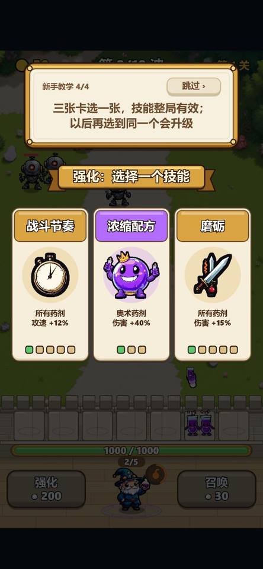 | 修之后：推荐标签，5 s 后出手 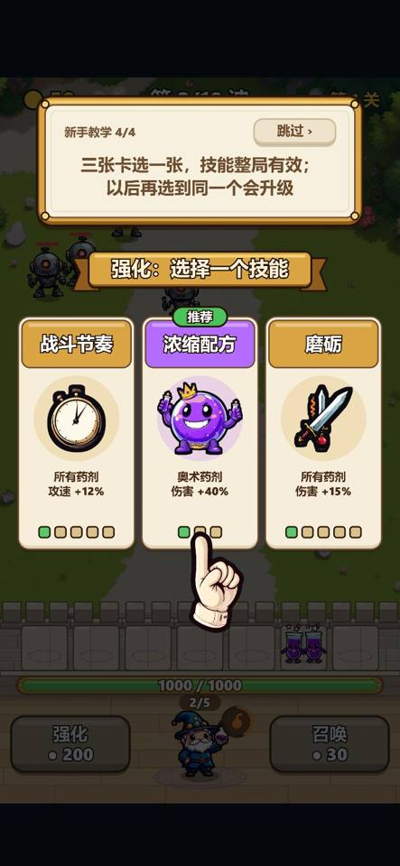 |
| 胜利页 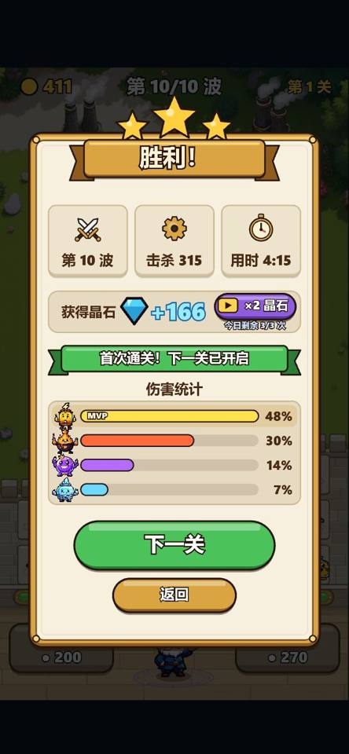 | 复活后 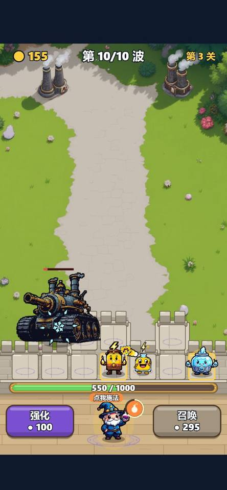 |
| 修之前：失败页三条一样 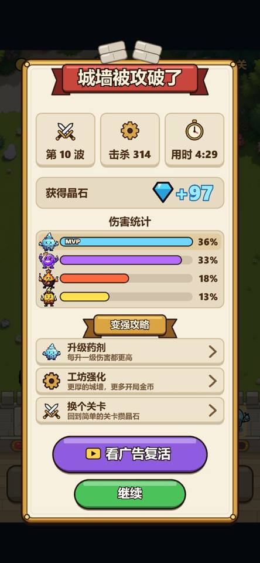 | 修之后：点亮"先做这个" 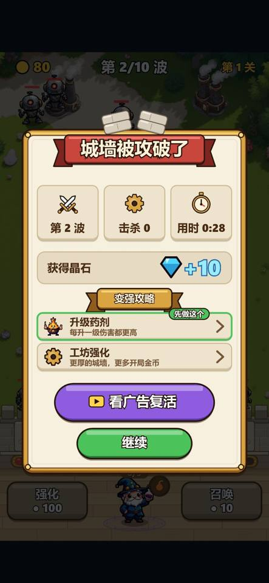 |
| 第一局在第一关就输（不再显示换关） 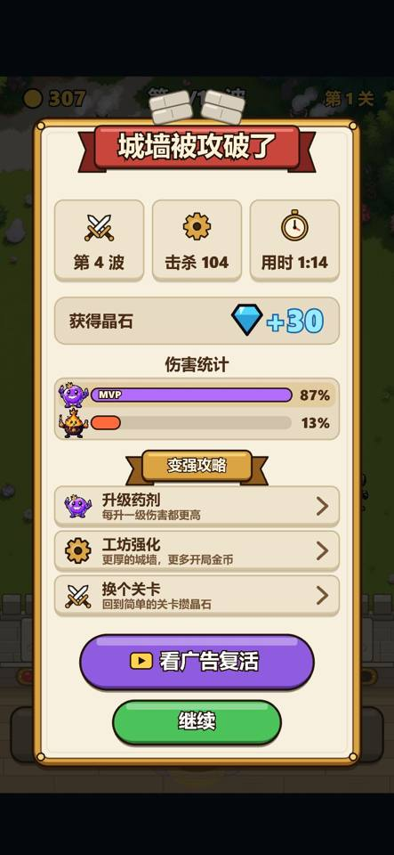 | 第一次进主页：隐私面板 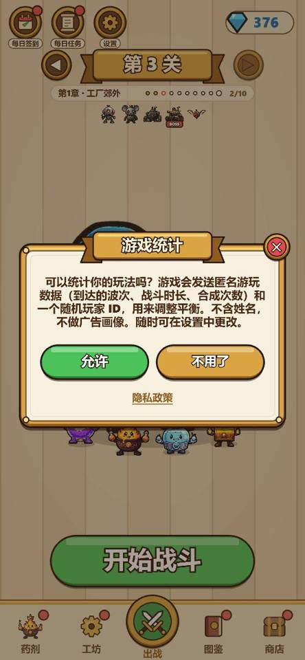 |
| 紧接着的签到面板 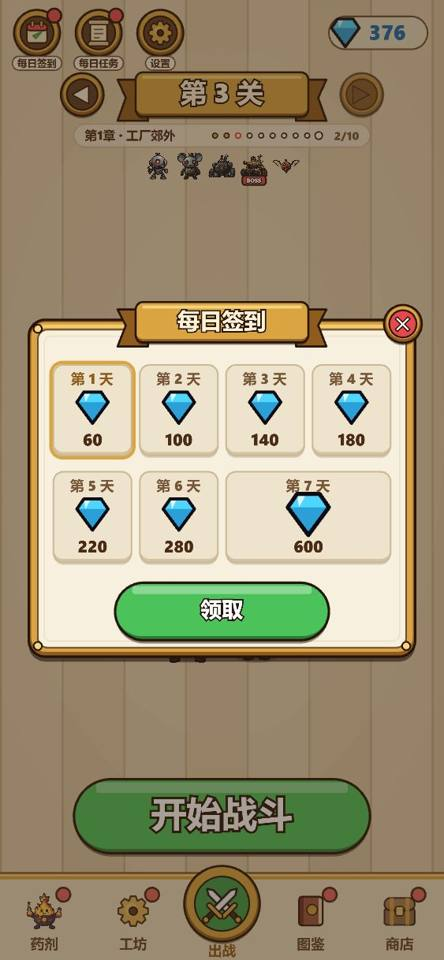 | 主页指引压在开始战斗上 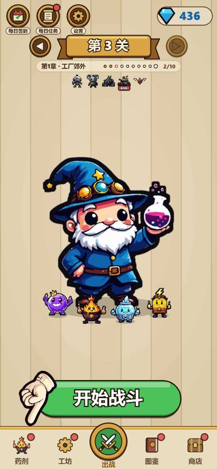 |
| 药剂页指引 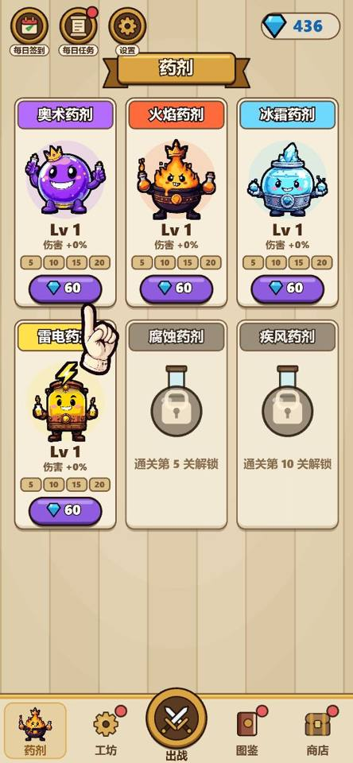 | 桌面 en：Top pick + 手 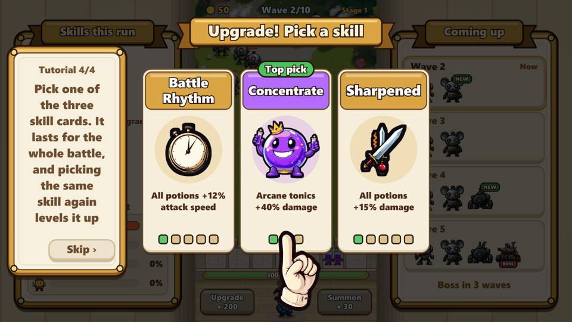 |
| 桌面 en：Do this first 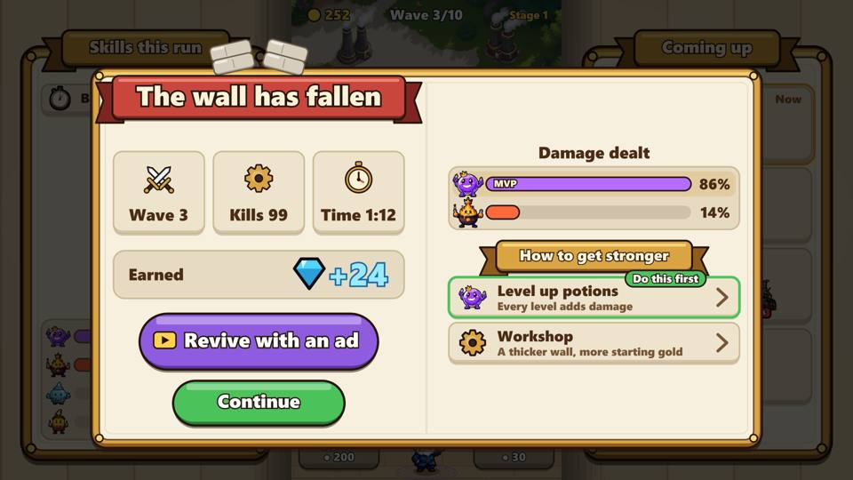 | 修之后：没有一对时指着召唤 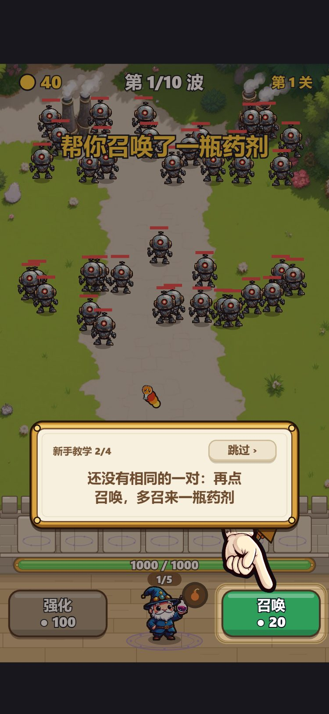 |
| 再召唤后出现一对，指向合成 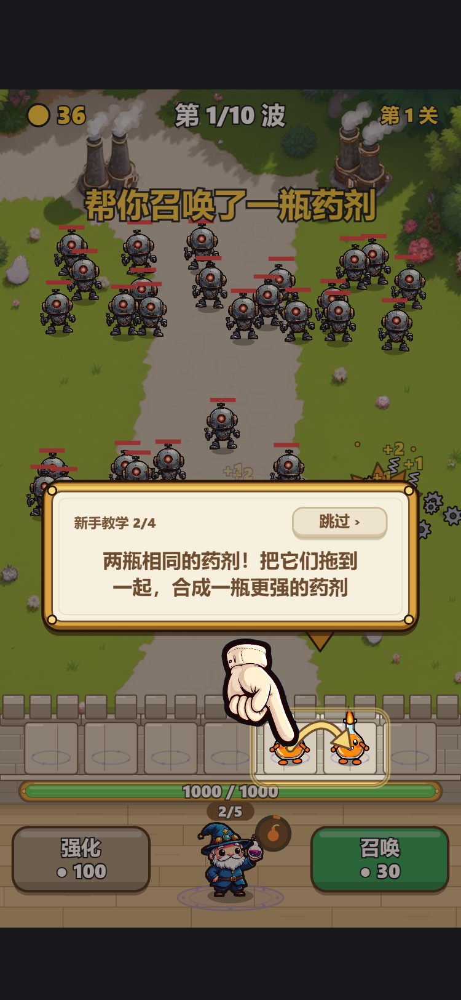 | 桌面 en：隐私之后不再弹签到，手在侧栏 Potions 上 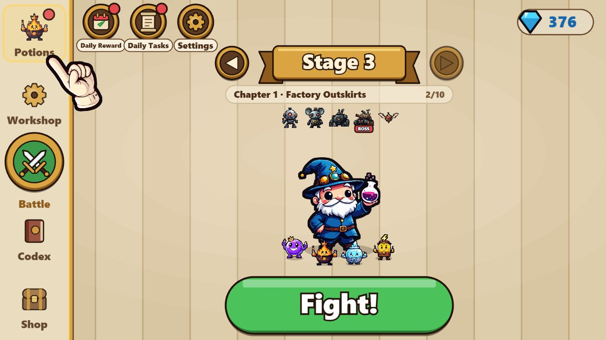 |
| 修之后：手从上方指向药剂，只亮药剂红点 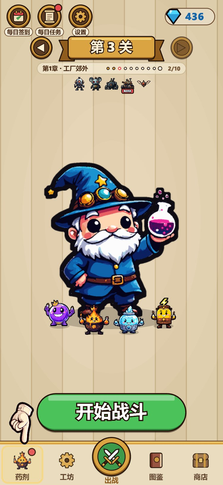 | 升级之后其余红点才亮 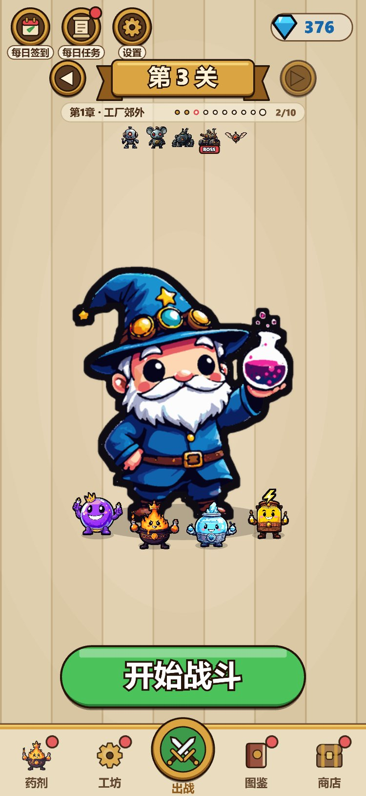 |
| 签到推到下一次进主页 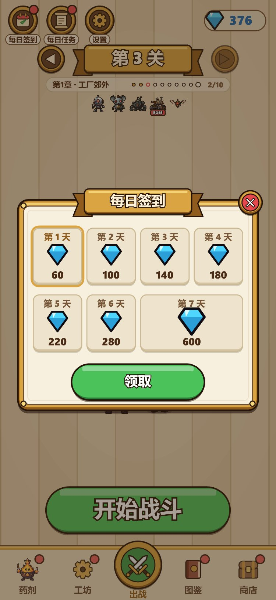 | 桌面 en：No matching pair yet 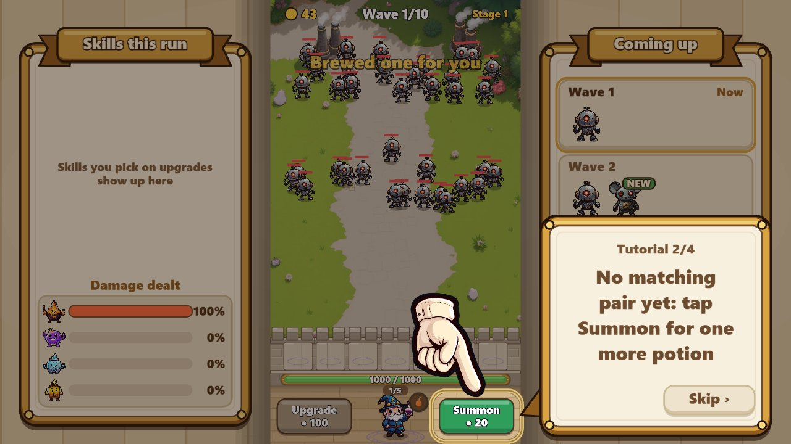 |

## 和线上数据对照（`npm run report`，ref/design/live-data-2026-10.md）

10 名玩家：first_input 1，summon 5，merge 4，run_end 2，没有人开第二局；会话中位数 28 s；D1 1/7；复活
提供 20 次、看了 2 次。样本太小，下不了结论。不过有一点对得上：中位数 28 s 正好落在合成到强化这一段，
在第一次选技能（32 s）之前。也就是说，大部分人还没走到这次改动的地方就走了，所以合成那段空等（第 3 步）
值得单独看。

## 本次修改（分支 claude/onboarding-check-d57371）

- `src/sim/suggest.ts`：`suggestSkill` 算出该推荐哪张卡。按场上药剂计分，每多一星分数翻倍；配方要两种药剂
  都在场；城墙低于一半才推荐修墙。只是给个指向，不会替玩家选。
- `src/view/overlay/cardNudge.ts`：推荐标签，加上卡牌放着不动 5 s 后出现、点在卡上的手；玩家一碰屏幕就收起。
  前 3 局才显示（`topPick`，`TOP_PICK_UNTIL=3`），自动战斗时不显示。战斗本来就在暂停，所以不会多冻结任何东西。
- `src/view/nudges.ts`：
  - `lossStep`：失败后点亮一条，依次是能升级的药剂 → 买得起的工坊项 → 换关
  - `lossTips`：第一关去掉换关那条
  - 升级指引改为 `runs >= 1`
- `endRows.ts` / `resultScreen.ts`：点亮的那条加绿边和"先做这个"药丸。
- 15 种语言加 `topPick` 和 `tip.now`。

## 第二轮修改（分支 claude/first-minute-fixes-1bd910）

- `src/sim/tutorial.ts`：合成这一步场上没有一对时，`showing` 返回新的提示 `'more'`（指着召唤）；`assist` 对它只等
  `PAIR_WAIT_SECONDS = 2` 秒就召唤。第一次自动召唤还在 8 s，第二次从 16 s 提前到约 10 s，自动合成从 24 s 提前到约 18 s。
  照样不冻结战斗，8 s 的 assist 没变（第三轮已整个去掉 assist，改为停住等玩家）；seed 609 的 stage 1、`scripts/first-seed.test.ts` 和 guard 都不受影响。
- `src/view/Tutorial.ts` / `src/game/tutorialFlow.ts`：`'more'` 算在 2/4，手指着召唤按钮。15 种语言加 `tutorial.more`。
- `src/game/homeScreen.ts` + `src/app.ts`（`consentVisit`）：这次进主页弹过隐私面板，签到就等下一次进主页。
  隐私面板仍然先弹，因为事件要等它答了才发。测试在 `src/game/homeEntry.test.ts`。
- `src/view/home/nav.ts`：竖屏的手从上方指向"药剂"页签，页签加亮框。
- `src/view/nudges.ts` / `src/view/Home.ts`：`navDots(m, today, pointing)`，指引在的时候页签只亮药剂。
  逐个看过其余红点：工坊（买得起）、图鉴（可领）、商店（今日宝箱）、出战（章节宝箱）、顶栏签到/任务（可领），
  都已经是"现在能领或买得起"的。只有药剂的"新的后备药剂"不算，但前三局碰不到它。

## 还没处理（建议作为后续）

1. 指引做完后，主页一下子亮 4–5 个红点（第 15 步）。每个都是真的，但如果还嫌多，可以只亮最便宜或者最该做的那一个。
   这牵涉红点规则的整体取舍，先不动。

## 第三轮：教学不再代打，改成停住等玩家（分支 claude/tutorial-pause-f83408，2026-10-25）

作者试玩新手局后决定：玩家不操作时不替他操作，而是停住战斗，等他按提示做。

- `src/sim/tutorial.ts`：去掉 `assist`、`ASSIST_SECONDS`、`PAIR_WAIT_SECONDS`。新增 `holds(b)`：提示指着召唤、
  "再召唤"（`'more'`）、合成、强化时为真；选卡本来就靠 `b.paused` 停，不算。
- `src/game/tutorialFlow.ts` 的 `held(g, b)` + `src/app.ts` 主循环：停住时既不跑 tick，也不往 `FixedStep` 里加时间，
  所以敌人、城墙、波次计时、画面插值全都不动；提示手指和卡片照常画、照常能点。每个 tick 之前都检查一次，
  一帧里中途变成"强化买得起"也会正好停在那一 tick。自动战斗（autoplay）不停。
- 暂停从哪开始：`HOLD_AFTER_SECONDS = 2`。开局第 0 秒就有 19 个敌人站在最上面，但站着不动的画面看不出"它们正冲过来"。
  先走 2 秒（走到大约五分之一的路，离城墙还有约 13 秒），停下时玩家看到的是一群正在逼近的敌人，召唤按钮的意义一眼就懂；
  2 秒也短到不会有人在这之前就走神。后面几步一出现就停。
- 回放和种子：停住是外壳不调用 `b.step()`，sim 里没有任何新状态，回放只记录玩家自己的指令（tick 不同而已），
  `checkReplay` 照样对得上（测试里验证了）。FIRST_SEED 609 的波次和敌人骰子与玩家操作无关，平衡守卫用 bot、不开教学，
  `npm run check:balance:quick` 不受影响。
- 埋点：`tutorial_assist` 不再发；`first_summon` / `first_merge` / `first_upgrade` 去掉 `by`；`tutorial_step` 去掉 `by`，
  加 `waitS`（真实秒数，因为战斗停着时 battle 秒不走，`doneT - shownT` 总是约 0）。collector 继续接收
  `tutorial_assist`，给还缓存着旧版的页面；report 有 `waitS` 时用它算"median s on screen"，旧数据里有 assist 时才显示 assist 比例。
- 15 种语言删掉 `tutorial.helped.*`（"帮你召唤了一瓶"之类），layout 测试里对应的三项一起删。
- 测试：`src/sim/tutorial.test.ts`（seed 609 放着不动 120 s 场面完全不变、无任何指令；每步操作后继续、下一步再停；
  停住期间下的指令回放一致；跳过后不再停），`src/game/tutorialFlow.test.ts`（autoplay 不停，`waitS` 的记录）。
