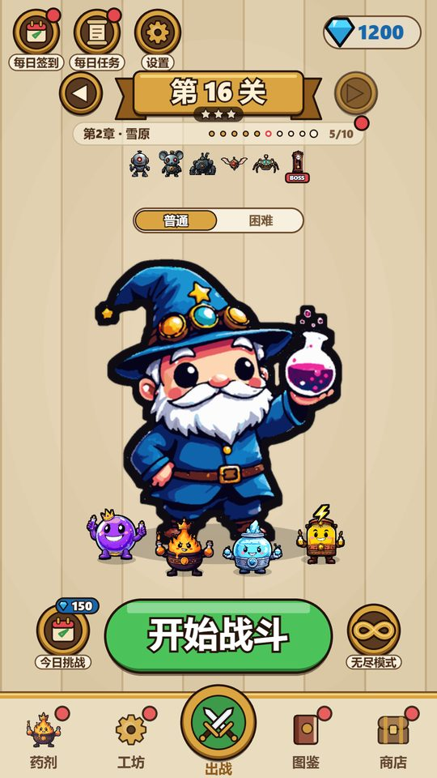
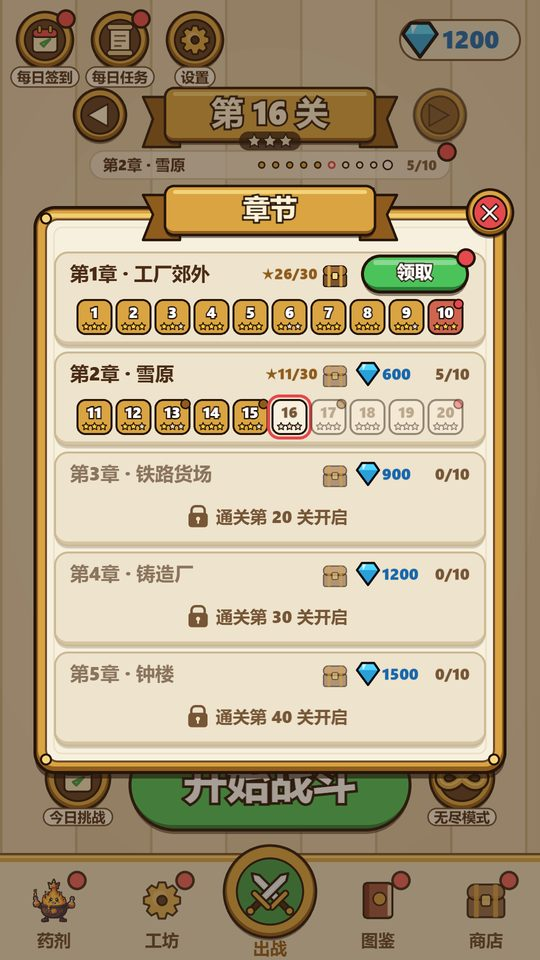
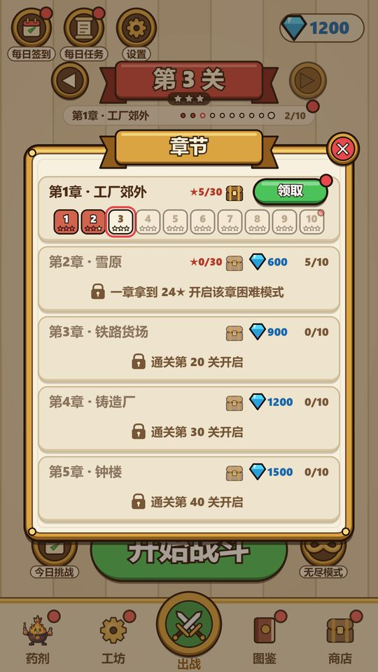
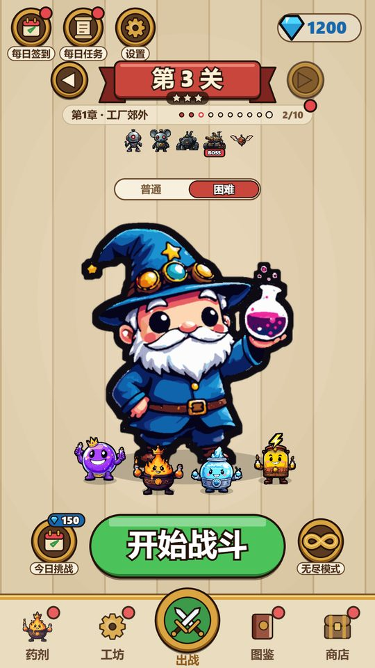
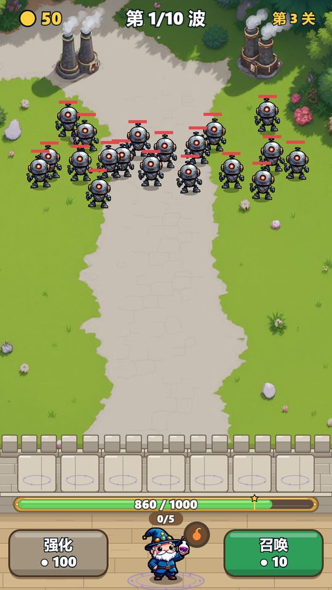
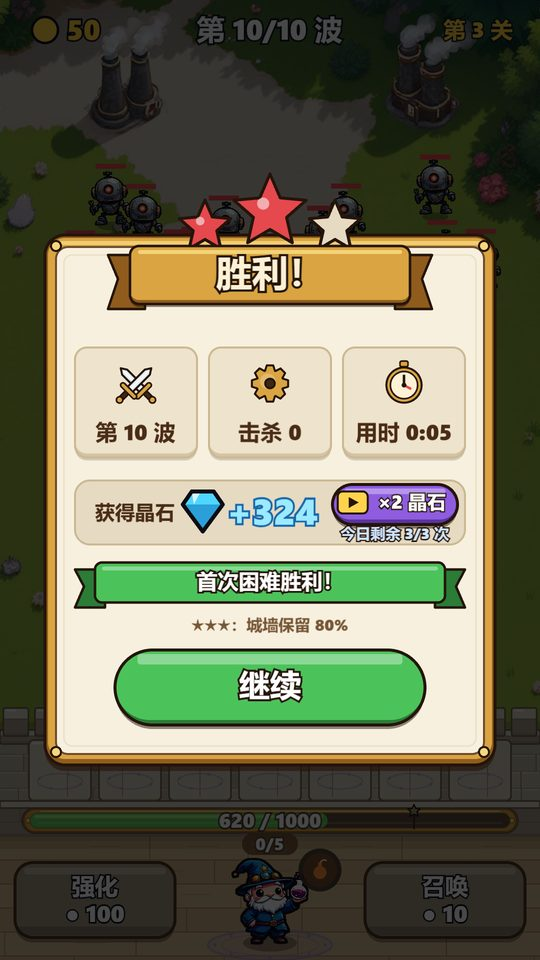
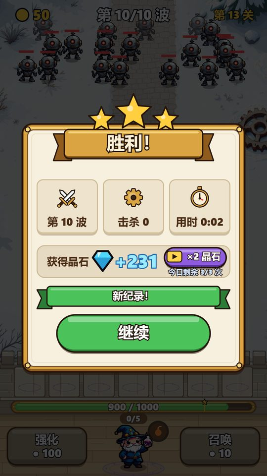

# 星级与困难模式（2026-10-22）

分支 `claude/stars-hard-modes-604a3c`。仿照 standing 的星级和困难模式（见 balance-review-2026-10 第七节），
目的是给通关后的玩家一个新的关卡目标，同时不拖慢休闲玩家的主线节奏。

代码：`src/sim/stars.ts`（规则、存档、奖励），探针 `npm run stars`（`scripts/stars.test.ts`），
经济模拟 `npm run economy`（`scripts/economyStars.ts` 是机器人的星级/困难策略，`STARS=0` 关掉做对照）。

## 一、星级规则

按胜利时**城墙剩余血量**给星，每关保留最好成绩：

| 星 | 条件 |
|---|---|
| 1★ | 胜利（复活过的胜利一律 1★，不管剩多少墙） |
| 2★ | 墙剩 ≥ 50% |
| 3★ | 墙剩 ≥ 80% |

- 和 standing 不同（standing 是 2★ 不复活、3★ 血量 ≥50%）：这里墙血是唯一的分数，复活本身就是靠广告买回来的墙，
  所以复活只给 1★；50 / 80 两档让 3★ 在前沿关卡确实难（见下表），回头刷低关又拿得到。
- 战斗中墙血条上 80% 处有一个小星标记（墙 ≥80% 时是金色，否则暗），复活过、挑战和无尽里不显示。
- 输了不给星，也不扣已有的星。

## 二、困难模式

**开放条件（按章）**：该章 10 关全部通关，且普通模式星数 ≥ **24 / 30**。
- 大约等于「八关 3★ 加两关 2★」，需要回头刷，但不要求全 3★。
- 出战页关卡卡片下面有「普通 / 困难」开关，通关第 1 章后出现。没有任何一章开放时点困难会抖动并提示条件。
- 困难关在章内**按顺序**解锁：第一关直接可打，之后要先赢前一关困难。

**难度**：同一关的波次、主题、Boss 不变，敌人：
- 血量按第 s+6 关的成长曲线放大（只取成长部分，保留第 s 关自己的 `stageHpScale` 主题系数）：
  第 5 关 ×1.97、第 10 关 ×1.77、第 15 关 ×1.36、第 20 关以后约 ×1.11。
- 移动速度 ×1.1。
- 不改关卡血量系数、卡牌和 Boss。

**奖励**（「按第 n+6 关算」）：
- 每局水晶 = 普通战斗公式（每波 5、胜利 55、击杀），但关卡系数用第 s+6 关（`stageStep` 0.1/关）。
- 每个困难关**第一次胜利**另加 0.5 × 首通奖励(30) × (s+6)：第 1 关 105，第 10 关 240，第 50 关 840；
  50 关合计约 23.6k。
- 都乘工坊的水晶加成。困难胜利不算主线首通：不开新关、不解锁药剂、没有章节宝箱，也没有「下一关」按钮。

**成就**（两条新线，奖励和其他线同档）：
- 摘星者：30 / 75 / 150 / 250 颗（普通+困难合计），100 / 200 / 400 / 800 水晶。
- 百炼成钢：赢 1 / 10 / 30 / 50 个困难关，100 / 200 / 400 / 800 水晶。

**存档**：`MetaSave.stars = { normal[50], hard[50], hardMode }`。旧存档迁移：已通关的每关记 1★；
读档时把每关星数夹到 0–3，已通关关卡至少 1★、未通关关卡 0★。

## 三、机器人探针（`npm run stars`，每格 12 局）

普通：玩家第一次打到这一关时的存档。困难：存档按第 s+6 / s+10 关的到达花费（困难要先打完整章、回头再来）。
数字是 12 局里胜利 / 至少 2★ / 3★ 的局数。

| 关 | 普通 胜/2★/3★ | 困难(+6 存档) | 困难(+10 存档) |
|---|---|---|---|
| 5 | 11 / 10 / 9 | 7 / 5 / 4 | 12 / 11 / 11 |
| 10 | 5 / 4 / 2 | 1 / 0 / 0 | 4 / 3 / 3 |
| 15 | 3 / 2 / 0 | 0 / 0 / 0 | 1 / 0 / 0 |
| 20 | 4 / 4 / 4 | 1 / 0 / 0 | 4 / 4 / 2 |
| 25 | 6 / 1 / 0 | 3 / 0 / 0 | 5 / 3 / 0 |
| 30 | 4 / 1 / 0 | 1 / 0 / 0 | 3 / 1 / 0 |
| 35 | 6 / 4 / 2 | 3 / 2 / 1 | 5 / 3 / 3 |
| 40 | 3 / 3 / 3 | 3 / 3 / 2 | 2 / 2 / 2 |
| 45 | 6 / 5 / 3 | 3 / 1 / 1 | 3 / 1 / 1 |
| 50 | 5 / 2 / 2 | 2 / 1 / 1 | 2 / 1 / 1 |

- 前沿关卡 3★ 很少（第 15、25、30 关为 0），要变强后回头刷，和 standing 的「先过关、后拿星」一致。
- 困难关对刚开放时的存档胜率 10–30%，再升几级（+10 存档）到 25–40%：是「回来挑战」的难度，
  不是刷钱关。第 5 关偏简单（第 1 章本来就简单），第 15 关偏难（第 2 章 Boss 关）。
- 机器人不会主动规避，真人胜率通常高于机器人。

## 四、水晶经济

`npm run economy`，每种玩家 3 个，机器人策略：前沿连输两次后不再刷主线最高关，而是先打最远的困难关
（连输两次困难就停，买东西后重置），否则刷农场关附近还没有 3★ 的最高一关。`STARS=0` 是改动前的策略。

通关第 10 / 20 / 30 / 40 / 50 关的天数（三个玩家）：

| 玩家 | 改动前 | 星级 + 困难 |
|---|---|---|
| 休闲，不看广告 | 4/13/20/30/**43**、4/14/23/34/**46**、5/15/23/29/**47** | 4/13/20/30/**43**、4/14/23/34/**46**、5/13/19/26/**45** |
| 休闲 + 广告 | 26–28 | 26–28（不变） |
| 常规，不看广告 | 19–20 | 19–24 |
| 常规 + 广告 | 10 | 10 |
| 重度，不看广告 | 7–9 | 7–10 |
| 重度 + 广告 | 4–5 | 4 |

- **休闲不看广告通关 50 关仍是 43–47 天**（目标 ~45 天）：主线期间困难关基本还没开或打不过，
  收入几乎不变（前 30 天战斗收入 7.4 / 7.0 / 7.5 万 → 7.5 / 6.9 / 8.0 万）。成就多出约 400 水晶。
- 全满级变慢：常规不看广告 72–73 天 → 76–107 天，重度 25 → 26–39 天，常规/重度看广告 50 → 80 天。
  原因是通关后机器人把时间花在困难关（胜率低，输了只拿波次钱）和刷 3★ 的低关，而不是刷第 50 关。
  这正是想要的效果：通关后有事可做，满级不再一两周就到。真人可以随时切回普通刷最高关，不会比改动前更慢。
- 首胜奖励总池约 23.6k + 成就 3k，相比满级所需（数十万）很小，不会让付费/广告节奏失衡。

## 五、界面（`?lang=zh`，1080×1920）

| | |
|---|---|
|  |  |
| 出战页：关卡牌下挂本关最好星数，卡片下「普通/困难」开关 | 章节面板：每章 ★n/30，每格关卡下 3 颗小星 |
|  |  |
| 困难模式：红色格子、按顺序解锁，未开放的章写「拿到 24★ 开启」 | 困难模式出战页：红色关卡牌和红色进度点 |
|  |  |
| 墙血条 80% 处的 3★ 标记（墙 86%，金色） | 困难首胜：红星、「首次困难胜利！」，不到 3★ 时提示「城墙保留 80%」 |
|  | |
| 普通关从 1★ 刷到 3★：「新纪录！」 | |

15 种语言都有 `stars.*` 和两条成就文案，15 语言布局测试通过。

## 六、没做的 / 以后

- 困难模式没有单独的排行或皮肤奖励；如果上线数据显示通关后留存仍低，可以加困难全 3★ 的章节徽章。
- 机器人刷星策略比较笨（固定在农场关附近找没满星的关），真实玩家的「刷困难 vs 刷第 50 关」比例要看上线数据：
  `stars` 事件带关卡、星数、是否困难。
